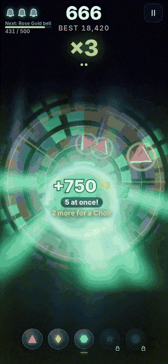
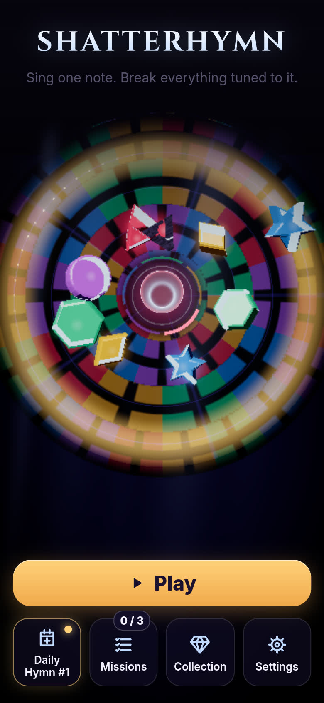
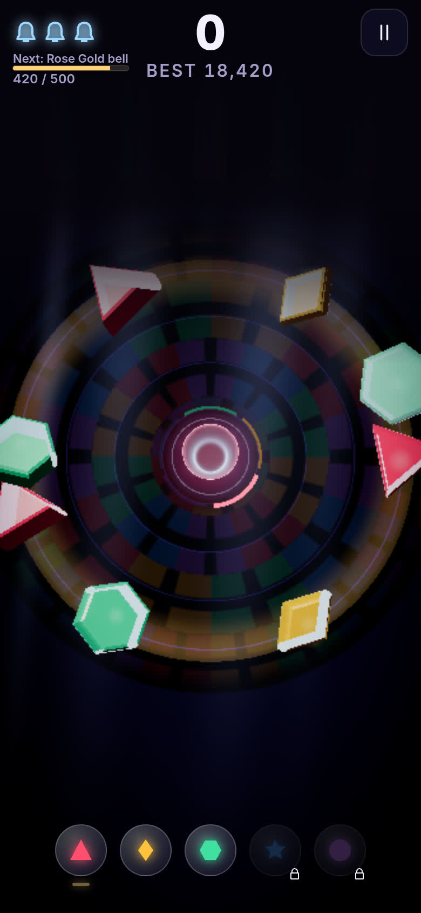
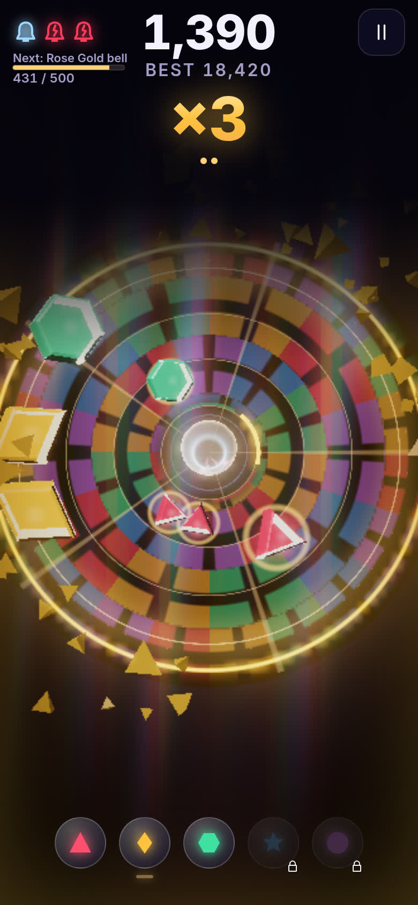

# Shatterhymn

<p align="center">
  <a href="https://aieatassam.github.io/shatterhymn/">
    
  </a>
</p>

<p align="center">
  <strong>Tap a colour button to shatter every crystal that matches.</strong><br/>
  A free one-thumb browser game — endless runs, freeze-frame juice, a daily seed, and a cathedral that sings when you play.
</p>

<p align="center">
  <a href="https://aieatassam.github.io/shatterhymn/"></a>
  
  
</p>

<p align="center">
  
  
  
</p>

---

## Play now

**[https://aieatassam.github.io/shatterhymn/](https://aieatassam.github.io/shatterhymn/)**

Works in a modern mobile or desktop browser. No account, no ads, no purchases. Saves stay on your device.

---

## How to play

1. **Tap a colour button** to strike that note right away.
2. Every targetable crystal of that colour shatters at once — bigger chords score far more.
3. **Protect the bell.** Crystals that touch it crack the glass. **Three cracks** and the run ends.
4. Chase your personal best, the **Daily Hymn** (same seeded cathedral for everyone that day), unlocks, and a share line you can send to a friend.

Tip: greed pays — wait for a fuller field — but waiting too long loses a life.

---

## Features

- **One-thumb** controls — tap a colour; learnable in a single try
- **Procedural endless** runs with rising speed, density and crystal kinds
- **Choir / Fever** multipliers and freeze-frame shatter juice
- **Daily Hymn** seed + optional friend seeds (`?seed=`)
- **Unlocks** — bell skins, musical scales, titles (earned with shards, never bought)
- **PWA** — installable, works offline after first load
- **Accessibility** — colour + shape + pitch for every note, Slower crystals, Reduce motion, readable UI
- **No dark patterns** — no ads, loot boxes, timers that take things away, or analytics

---

## Design note: seven principles

Shatterhymn is shaped by Malone & Lepper’s seven motivations for learning games (and a Hooked-style loop without the extractive bits):

| Principle | In Shatterhymn |
|---|---|
| **Challenge** | Keep crystals off the bell; score climbs as speed and greed rise. Every strike gives immediate, size-scaled feedback. |
| **Fantasy** | The bell *sings*, singing *breaks* glass — cathedral, choir language and materials serve one image. |
| **Curiosity** | New scales change the sound; new crystal kinds arrive on a schedule; locked unlocks show exactly what’s next. |
| **Control** | You choose when, which note and how greedy. Strike results are fully predictable from the screen. |
| **Cooperation** | Daily Hymn is the same cathedral for everyone; friend seeds let you send a run. |
| **Competition** | Personal / daily bests and a share line — player-to-player, no fake leaderboards. |
| **Recognition** | Share card, titles, New best! moments, Choir counts. |

Ethics hard rules live in `docs/design.md` §17: no purchases, ads, gacha, rigged near-misses, notifications or analytics.

---

## Controls

| Input | Action |
|---|---|
| Tap colour / 1–5 | Strike that colour |
| Release | Shatter every crystal matching the current note |
| Pause | Top-right pause (run pauses when the tab is hidden too) |

Settings: Slower crystals, Reduce motion, volumes, haptics (where supported).

---

## Tech stack

- **TypeScript** + **Vite** + **Vitest**
- **three.js** + **postprocessing** (WebGL cathedral, crystals, shatter FX)
- **PWA** service worker with precache
- Local saves only — no backend

---

## Local development

```sh
npm install
npm run dev          # http://localhost:5173
npm run check        # typecheck + lint + tests + production build
npm run build        # output in dist/
npm run preview      # serve dist locally
```

GitHub Pages deploys from `.github/workflows/deploy.yml` on every push to `main` (build + test, then `actions/deploy-pages`).

---

## Inspiration and credits

Shatterhymn is an original game. It borrows *feel*, not assets or systems, from:

- ***Rez*** / Tetsuya Mizuguchi — play that becomes music
- ***Peggle*** (PopCap) — rising pitch and an over-the-top finale
- ***Wordle*** (Josh Wardle) — the emoji share line
- ***Celeste*** and ***Hollow Knight*** — freeze-frame and hit-flash timings (via game-feel research)

**No affiliation.** Shatterhymn is not endorsed by or associated with the creators or publishers of those works.

### Audio (CC0 1.0)

Impact and UI sounds from [Kenney](https://kenney.nl) packs (*Impact Sounds*, *Interface Sounds*), converted and normalised for this game. Full table in [`CREDITS.md`](CREDITS.md). Bell tones and music are synthesised in the browser (Web Audio).

### Fonts (SIL OFL 1.1)

Cinzel (Natanael Gama) and Inter (Rasmus Andersson).

### Libraries

three.js (MIT), postprocessing (Zlib), Vite / Vitest (MIT), TypeScript (Apache-2.0).

---

## Licence

Code and original game design materials: **[MIT](LICENSE)** — Copyright (c) 2026 Aieat Assam.

Audio: CC0 (Kenney). Fonts: SIL Open Font License 1.1. See [`CREDITS.md`](CREDITS.md).
