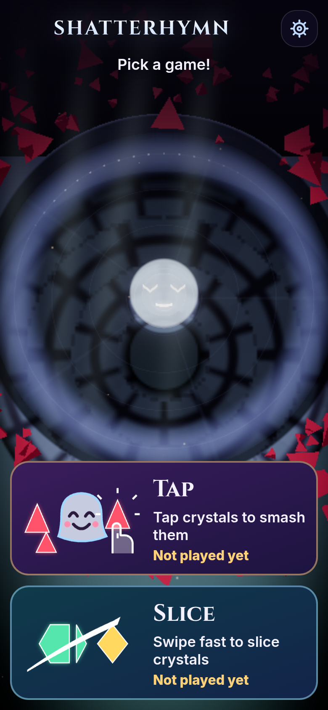
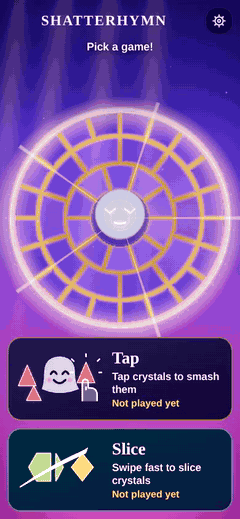
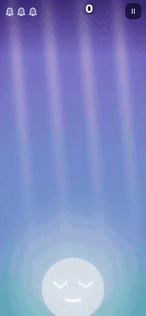
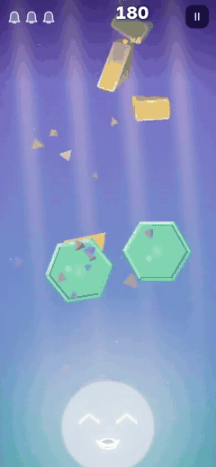

# Shatterhymn

Tap or slice glowing crystals and keep the singing bell safe. Shatterhymn is a free one-thumb browser game.

<p align="center">
  <a href="https://aieatassam.github.io/shatterhymn/"></a>
  
  
</p>

<p align="center">
  
  
  
</p>

<p align="center">
  <br/>
  <sub>A Slice cut at real speed: bright trail, glowing halves, colour splash</sub>
</p>

## Play now

[Play Shatterhymn](https://aieatassam.github.io/shatterhymn/) in a modern mobile or desktop browser. Saves stay on your device.

## Two ways to play

**Tap:** Tap a crystal. Every crystal of that colour smashes too. Keep crystals away from the bell. The bell has a face and reacts as you play.

**Slice:** Swipe fast through crystals as they fly up. Slice several in one swipe for "Nice!", "Great!" and "Amazing!" bonuses. Watch for fans, crossing pairs, lobs and crystal rain, big crystals that take three hits, and a Crystal Rush with double points at 30 seconds. Don't hit dark crystals, and don't let crystals fall. A slow drag does not cut: the blade cuts only above about 2.4 short screen sides per second (about 940 px/s on a phone). One swipe cuts at most 6 crystals; lift your finger to slice again.

Each mode has its own best score and Daily game. The short intro on first launch can be skipped with any tap, click or key.

| Mode | Controls |
|---|---|
| Tap | Tap a crystal or use keys 1–5. |
| Slice | Swipe fast or drag the mouse fast. |
| Both | Press P or Esc to pause. |

## Tech stack

- TypeScript, Vite and Vitest
- three.js and postprocessing for WebGL visuals
- PWA service worker with precache
- Local saves, with no backend

## Local development

```sh
npm install
npm run dev          # local development server
npm run check        # typecheck, lint, tests and production build
npm run build        # output in dist/
npm run preview      # serve dist locally
npm run layout       # browser layout checks
```

GitHub Pages deploys from `.github/workflows/deploy.yml` on pushes to `main`.

## Credits

Slice mode is inspired by Fruit Ninja by Halfbrick Studios. Shatterhymn is not affiliated with or endorsed by Halfbrick Studios.

Impact and UI sounds are from Kenney's CC0 packs. Bell tones and music are synthesised in the browser. Cinzel and Inter fonts use the SIL Open Font License 1.1. See [CREDITS.md](CREDITS.md) for full credits and inspirations.

## Licence

Code and original game design materials are licensed under the [MIT licence](LICENSE). Copyright (c) 2026 Aieat Assam.
